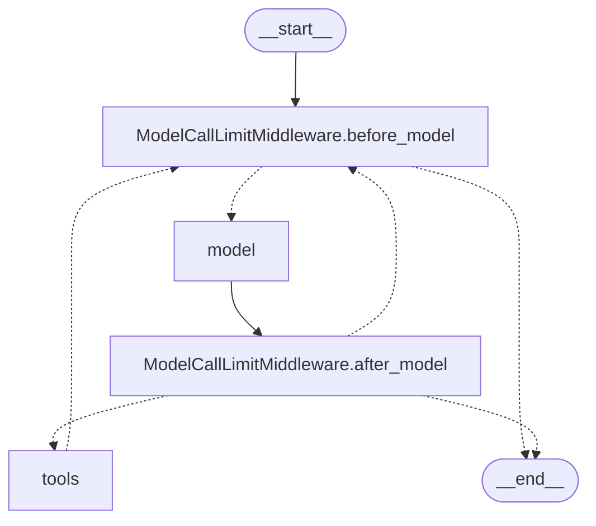

# Лабораторная 1. Агент-организатор файлов: LangGraph ReAct, tools, MCP, skills

Я сделала диалогового помощника, который раскладывает файлы из `workspace/input/` по тематическим папкам `workspace/data/`.
Он ведёт каталог `workspace/catalog.json` со стабильными `document_id`, а по запросу сохраняет точные выдержки
с метаданными в Elasticsearch через MCP-сервер. Каталог и индекс выдержек дальше пойдут на вход лабораторной № 3.

## Содержание
1. [Архитектура](#1-архитектура)
2. [Установка и запуск](#2-установка-и-запуск)
3. [Инструменты](#3-инструменты-tools)
4. [Граф готового ReAct-агента](#4-граф-готового-react-агента)
5. [История диалога в CLI](#5-история-диалога-в-cli)
6. [Elasticsearch через MCP](#6-elasticsearch-через-mcp)
7. [Skills](#7-skills)
8. [Контракт данных: каталог и выдержки](#8-контракт-данных-для-лабораторной-3)
9. [Пример диалога и трассы](#9-пример-диалога-и-трассы)
10. [Тесты и проверочные сценарии](#10-тесты-и-проверочные-сценарии)
11. [Ограничения](#11-ограничения)

---

## 1. Архитектура

```
 ┌──────────────── CLI (organizer/cli.py) ──────────────────────────────┐
 │ HumanMessage → agent.astream(stream_mode="updates")  → трасса JSONL+MD│
 │ thread_id = id сессии, InMemorySaver checkpointer                     │
 └───────────────┬──────────────────────────────────────────────────────┘
                 ▼
 ┌──────── langchain.agents.create_agent (готовый ReAct на LangGraph) ──┐
 │  model (ChatOpenAI → qwen3.8-27b, ИТМО)  ⇄  tools (ToolNode)          │
 │  middleware: ModelCallLimit (лимит вызовов модели за ход),            │
 │              ToolGuard (таймаут / ошибки → наблюдение / лимит вывода),│
 │              CatalogSync (проверка выдержек и статус индексации)      │
 └──────┬──────────────────────────────┬────────────────────────────────┘
        │ 12 локальных tools           │ 6 MCP tools (stdio)
        ▼                              ▼
 workspace/ (Workspace guard)    mcp_es/server.py (FastMCP) ──► Elasticsearch 9.5.5
  input/  data/  catalog.json      upsert/search/update_path/...      индекс itmo_lab1_excerpts
```

| Каталог / файл | Назначение |
|---|---|
| `organizer/agent.py` | сборка агента: `create_agent(model, tools, system_prompt, middleware, checkpointer)` |
| `organizer/prompts.py` | системный промпт |
| `organizer/cli.py` | диалоговый CLI, история, ремонт истории после лимита, трассы |
| `organizer/tools_fs.py` | `read`, `head`, `tail`, `grep`, `ls`, `write`, `move` |
| `organizer/tools_web.py` | `web_fetch` |
| `organizer/pathguard.py` | нормализация путей, разрешение symlink/junction, проверка принадлежности workspace |
| `organizer/catalog.py`, `tools_catalog.py` | каталог (`catalog_view`, `catalog_update`) и `build_excerpts` |
| `organizer/skills.py` | реестр skills и tool `load_skill` |
| `organizer/middleware.py` | `ToolGuardMiddleware`, `CatalogSyncMiddleware` |
| `organizer/mcp_client.py` | подключение MCP-сервера через `langchain-mcp-adapters` |
| `mcp_es/` | собственный тонкий MCP-сервер над Elasticsearch, схема выдержки |
| `skills/organize_files/SKILL.md`, `skills/index_excerpts/SKILL.md` | два skill по спецификации Agent Skills |
| `fixtures/` | тестовые файлы (`input/`, `late/`) и `EXPECTED.md` |
| `scripts/` | `run_all_demos.ps1` (вся цепочка демо), подготовка workspace, добавление файлов из второго терминала, проверка (`verify.py`), экспорт и восстановление индекса, экспорт графа, сводка прогона (`summarize_run.py`), локальный HTTP-сервер для `web_fetch` (`http_fixture_server.py`) |
| `demo/` | сценарии диалога для трасс |
| `traces/` | трассы сессий (`*.jsonl` и `*.md`) |
| `results/` | снимок workspace, каталог, выгрузка индекса, отчёты `verify`, сводка прогона `RUN_SUMMARY.md` |

Версии зафиксированы в `requirements.txt` (полный lock лежит в `requirements.lock.txt`): Python 3.13.7 (подойдёт любой ≥ 3.11),
langchain 1.5.0, langgraph 1.2.22, langchain-openai 1.8.0, langchain-mcp-adapters 0.3.2, mcp 1.30.0,
elasticsearch-py 9.5.1, Elasticsearch 9.5.5 (Docker).
В текущей документации `create_react_agent` помечен устаревшим, поэтому я взяла `langchain.agents.create_agent`.
Это та же библиотечная фабрика ReAct-агента на LangGraph, задание её разрешает.

## 2. Установка и запуск

Нужны Python ≥ 3.11, Docker Desktop и доступ к сети ИТМО: LLM-сервер `10.32.2.11` виден только из неё.

```powershell
cd lab1
python -m venv .venv
.venv\Scripts\Activate.ps1
pip install -r requirements.txt
copy .env.example .env          # впишите LLM_API_KEY (личный токен; .env в .gitignore)
docker compose up -d            # Elasticsearch 9.5.5 на http://localhost:9200
python scripts/prepare_workspace.py --reset-index   # workspace/input = fixtures/input, пустая data/, чистый индекс
```

Диалоговый CLI запускается так:

```powershell
python -m organizer.cli
```

Команды CLI: `/help`, `/history` (статистика сообщений), `/check` (проверка пар tool_call/tool_result и дублей),
`/catalog`, `/graph` (mermaid-схема), `/exit` (также `/quit`, `выход`, Ctrl+Z/Ctrl+C).

Файлы, которые появляются во время открытой сессии, CLI сам не копирует. Пока сессия открыта, пользователь кладёт
их в `workspace/input/` сам: во втором терминале запускает `python scripts/add_late_files.py` (скрипт копирует
`fixtures/late/*`) или переносит файлы через Проводник. Потом пишет агенту «Я добавил файлы, разбери новые», и агент
видит их при повторном `ls`.

В режиме сценария (`--script`) вместо этого стоит пауза. Строка `@wait_for_files input/a.md input/b.md` останавливает
чтение реплик, пока эти файлы не появятся в `input/`. CLI раз в 0,5 с проверяет, что файл появился и его размер
перестал меняться; таймаут задаётся `--wait-timeout`, по умолчанию 600 с. На время паузы CLI пишет файл-маркер
(`--wait-marker`), по нему внешний скрипт понимает, что пора добавлять файлы. В трассе остаются события `harness_wait` и
`user_action: external_files_added` с полем `added_by: "another process (this CLI only waited, copied nothing)"`.
Старую директиву `@add_late_files`, при которой файлы копировал сам CLI, я оставила для совместимости, в демо она не используется.

Основной диалог можно прогнать вручную:

```powershell
python -m organizer.cli --script demo/dialog_ru.txt
#   когда CLI напишет "[пауза сценария]", во втором терминале: python scripts/add_late_files.py
python scripts/verify.py          # детерминированные проверки → results/verify_report.json
python scripts/export_index.py    # results/index_export.jsonl, catalog.json, data_tree.txt, workspace_snapshot/
```

Все трассы и все `results/` пересоздаются одной командой из корня репозитория (скрипт сам переходит в `lab1`).
Работает это только из сети ИТМО. В финальном прогоне 21.11.2026 шесть сессий от сброса workspace (00:30:04) до конца
последней сессии (00:38:50) заняли меньше 9 минут. До них идут тесты (полный `pytest` у меня занимает около минуты),
после них проверка, экспорт и коммит.

```powershell
powershell -ExecutionPolicy Bypass -File lab1\scripts\run_all_demos.ps1
```

Порядок шагов в скрипте: проверка LLM → `docker compose up` → `pytest` и тесты выхода через ссылки (`results/symlink_test.txt`) → чистый workspace и пустой индекс → цепочка из шести сессий
(раздел 9) → `verify` → экспорт индекса и графа → `results/RUN_SUMMARY.md` → поиск токена в `traces/` и `results/` →
удаление трасс прежних прогонов (они не относятся к этой цепочке) → `git commit` **только** `lab1/traces` и
`lab1/results` → `git push`. Если `verify` не прошёл, старые трассы остаются на месте и ничего не коммитится.
То есть в конце скрипт сам коммитит и пушит `traces` и `results`. Если этого не нужно (например, прогон пробный),
его запускают с `-SkipPush`: тогда всё остальное выполняется, а `git add`/`commit`/`push` пропускаются.
Остальные ключи: `-SkipTests`, `-KeepOldTraces`. `-DryRun` проверяет логику скрипта без LLM: вместо модели
работает детерминированная заглушка `--dry-run-model`, запуск идёт только на копии `lab1` вне git-репозитория и без коммита.

Индекс можно восстановить и без LLM (это вход для лабы 3): `python scripts/restore_index.py` создаёт его заново
из `results/index_export.jsonl`.

## 3. Инструменты (tools)

Все tools типизированы (Pydantic `args_schema` с описаниями) и возвращают один и тот же JSON-конверт:
`{"ok": true, "tool": "...", "data": {...}}` или `{"ok": false, "tool": "...", "error": {"type", "message", ...}}`.
Ошибки я отдаю модели как наблюдения, а не бросаю исключения. Неверный `n`, отсутствующий файл, конфликт имён,
HTTP-ошибка и таймаут превращаются в `error.type = invalid_argument | not_found | name_conflict | http_error | timeout`.
Чтобы неудачный вызов было видно и в трассе, `ToolGuardMiddleware._bound` (`organizer/middleware.py`) ставит
`ToolMessage.status = "error"`, если ответ tool начинается с конверта `"ok": false`. Сначала я проверяла только
компактный `{"ok": false`, а настоящий MCP-сервер отдаёт JSON с отступами (`{` и перевод строки перед `"ok": false`),
и в прогоне 20.11 его ответы `es_unavailable` попали в трассу как `status: success`. Теперь регулярное выражение
`_FAILED_RX` допускает пробелы и переводы строк, и тест `test_failed_tool_result_has_error_status` проверяет оба
формата. В финальном прогоне 21.11 я сверила все шесть трасс: у всех 17 результатов с `ok: false` (3 в main, 11 в guard,
2 `es_unavailable` в errors, 1 `mcp_unavailable` в mcp_down) стоит `status: error`, у остальных `success`.

| Tool | Аргументы | Поведение |
|---|---|---|
| `read` (cat) | `path`, `numbered=false` | текст, путь, `truncated`, `total_lines`, `content_hash`; `numbered` — номера строк для выбора выдержек |
| `head` / `tail` | `path`, `n` | первые / последние `n` строк в исходном порядке; `n` — положительное целое; короткий файл → все строки; пустой → пустой результат |
| `grep` | `pattern`, `path`, `recursive`, `max_matches`, `ignore_case`, `regex` | буквальная подстрока (regex — расширение); `{path, line (с 1), text}`, `total_matches`, `has_more`, `remaining` |
| `ls` | `path` | один уровень: имя, тип, размер; стабильный порядок (папки, затем файлы по имени); для документов — `document_id`, title, description, статус; новые файлы видны при повторном вызове |
| `write` | `path`, `content`, `mode` | UTF-8, `overwrite`/`append`, создаёт родительские папки; запрещено писать в `catalog.json`, в `input/` и поверх каталогизированного документа |
| `move` | `source`, `destination` | input → data или data → data; создаёт папки; никогда не перезаписывает (`name_conflict` + `suggested_name`); проверяет, что старого пути нет, новый есть и hash не изменился; регистрирует или обновляет документ в каталоге; сообщает `action_required`, если индекс нужно синхронизировать |
| `web_fetch` | `url` | только http(s); таймаут, лимит байт и редиректов; `url`, `final_url`, `status`, `title`, `text` (HTML → текст), `truncated` |
| `catalog_view` | `folder`, `status`, `document_id` | записи каталога и отчёт сверки (пропавшие или незарегистрированные файлы) |
| `catalog_update` | `document_id`, `title`, `description`, `note` | описание документа, обоснование классификации |
| `build_excerpts` | `document_id`, `ranges` | точный текст строк, `content_hash`, стабильный `excerpt_id`; без `ranges` повторно использует прежние диапазоны |
| `load_skill` | `name` | полный текст SKILL.md по требованию |

Защита путей сделана в `pathguard.py`. Путь интерпретируется относительно workspace и нормализуется, все symlink
и junction разрешаются (`Path.resolve`), и только после этого проверяется `relative_to(workspace)`.
Так блокируются `../`, абсолютные пути наружу и symlink/junction наружу. `move` не перемещает сами ссылки.
`grep -r` не заходит в каталог-ссылку или junction, который ведёт за пределы workspace. `os.walk` сам по symlink
не идёт, но в NTFS junction заходит, поэтому `grep` проверяет каждый подкаталог до обхода. Такая ссылка попадает
в `skipped` под своим именем с причиной `link_outside_workspace`, а имена файлов за ней в ответ не попадают.
Файловый symlink наружу пропускается с причиной `symlink_outside_workspace`. В `files_scanned` такая пропущенная
ссылка не вычитается. Раньше вычиталась, и в сессии guard прогона 20.11 `grep -r input` вернул `files_scanned: -1`
(в `input` нет файлов, только ссылка). В финальном прогоне там `files_scanned: 0`.

Как я это проверяла:
- `../` (в том числе `input/../../x`) и абсолютные пути наружу проверяют `test_dotdot_escape_blocked` и
  `test_absolute_path_outside_blocked` (все инструменты: read, ls, write, move, grep);
- directory junction (точка повторной обработки NTFS; именно так выглядит выход по ссылке на Windows без
  особых прав) проверяет `test_junction_escape_blocked_windows`: read/head/tail/write/ls/grep/move через junction,
  абсолютный путь через junction, абсолютный путь к цели, комбинация с `../`; файл снаружи остаётся на месте.
  Для `grep -r input` тест требует, чтобы в `skipped` была сама ссылка `input/junction` с `link_outside_workspace`
  и не было имени `secret.txt`, которое лежит за ней.
  Такой же junction (`input/outside_link`) скрипт демо создаёт перед сессией guard, и модель обращается к нему
  настоящими вызовами tools (раздел 9);
- настоящий symlink (файловый и каталожный) проверяет `test_symlink_escape_blocked`. Он выполняется там, где
  создавать symlink разрешено: Linux/macOS, Windows с включённым режимом разработчика (Параметры → Обновление и
  безопасность → Для разработчиков → «Режим разработчика») или под администратором. Без этих прав тест помечается
  `skipped` с пояснением. В финальном прогоне 21.11 режим разработчика на моей машине был включён, и тест прошёл.
  `pathguard` обрабатывает оба вида ссылок одним кодом (`Path.resolve` + `os.path.islink`/`os.path.isjunction`).
  `run_all_demos.ps1` перед цепочкой отдельно запускает `pytest tests/test_tools_fs.py -k "symlink or junction"` и
  сохраняет вывод в `results/symlink_test.txt` вместе с состоянием режима разработчика (оно только читается из
  реестра, ничего не меняется) и строкой `status:`. При включённом режиме там будет `real symlink test PASSED`, при
  выключенном `skipped: no symlink privilege ...`, и это не считается ошибкой прогона. В прогоне 21.11 в файле записано
  `Windows Developer Mode: on`, `status: real symlink test PASSED (symlinks are allowed on this machine)` и
  `2 passed, 33 deselected`. Если любой из этих тестов падает, скрипт останавливается.

Лимиты вывода. Каждый tool ограничен `MAX_TOOL_OUTPUT_CHARS` (12000): при превышении ставится флаг `truncated` и
подсказка дочитать через head/tail/grep. Кроме того, `ToolGuardMiddleware` обрезает результат любого tool, в том числе MCP.

Лимиты выполнения: `AGENT_MODEL_CALLS_PER_TURN=25` (`ModelCallLimitMiddleware`, `exit_behavior="end"`),
`AGENT_RECURSION_LIMIT=110` super-step графа за ход, таймаут tool 30 с (`ToolGuardMiddleware`), таймаут хода 600 с,
таймаут и retry LLM (`ChatOpenAI(timeout=120, max_retries=2)`), таймаут ES 10 с.
Один вызов модели занимает 4 super-step (`before_model`, `model`, `after_model`, `tools`), поэтому
`recursion_limit` должен быть больше `4 × 25 = 100`. Тогда первым мягко срабатывает лимит вызовов модели, а
`recursion_limit` остаётся страховкой. Сначала у меня стояло 100, и цикл из 25 вызовов упирался именно в него; это
поймал тест `test_default_limits_let_model_call_limit_fire_first`. Сработавший лимит CLI записывает в трассу
(`turn_end.stopped_by = model_call_limit | recursion_limit | turn_timeout`) и в ответ.

## 4. Граф готового ReAct-агента

Граф я получила из скомпилированного агента (`python scripts/export_graph.py` → `docs/graph.mmd`, или `/graph` в CLI):



Узлы и рёбра создала библиотека: `create_agent` строит `model` и `tools` (ToolNode), а middleware с хуками
`before_model`/`after_model` добавляет свои узлы. Пунктиром показаны условные переходы.

Как проходит один ход (это можно сверить с полем `transitions` в трассе):

1. `__start__`: в канал `messages` приходит новый `HumanMessage`. Reducer `add_messages` дописывает его
   к истории из checkpointer'а (по `thread_id`), а не заменяет её.
2. `ModelCallLimitMiddleware.before_model` проверяет счётчик вызовов модели за ход. Если лимит превышен, он
   переходит в `__end__` с сообщением о лимите. Так и заканчивается зацикленный сценарий.
3. `model` вызывает LLM с system prompt, всей историей и схемами 18 tools и получает `AIMessage`. В нём может быть список `tool_calls` (`id`, `name`, `args`).
4. `after_model` и условный переход: если в `AIMessage` есть `tool_calls`, управление идёт в `tools`,
   иначе в `__end__` (финальный ответ).
5. `tools` (ToolNode) выполняет все вызовы шага параллельно. Каждый вызов проходит через `wrap_tool_call`:
   сначала `ToolGuard` (таймаут, исключение → error-наблюдение, лимит вывода), потом `CatalogSync` (только для
   MCP-tools индекса), потом сам tool. На каждый вызов создаётся `ToolMessage` с тем же `tool_call_id`. Невалидные
   аргументы ToolNode сам превращает в error-`ToolMessage`.
6. `tools` → `before_model` → `model`: модель снова получает управление, теперь вместе с наблюдениями. Цикл повторяется, пока она не ответит без tool calls.
7. Ход заканчивается финальным `AIMessage` без tool calls, срабатыванием лимита вызовов модели (`end`) или
   `recursion_limit` (`GraphRecursionError`). В последнем случае CLI закрывает «висящие» tool calls
   error-`ToolMessage` через `aupdate_state(as_node="tools")`, чтобы история осталась валидной.
   После каждого super-step состояние сохраняется в checkpointer.

Почему в `transitions` бывает несколько `tools` подряд. `create_agent` отправляет каждый tool call из одного
`AIMessage` в узел `tools` отдельной задачей (`Send("tools", [tool_call])`). Все эти задачи выполняются в одном
super-step, но `astream(stream_mode="updates")` отдаёт результат каждой задачи отдельным обновлением, и CLI записывает
каждое как переход. Поэтому N параллельных вызовов дают N записей `tools` подряд, а в трассе N событий `graph_step`
с одним `ToolMessage` в каждом. Пример из retry (`session_20261121_003801_e59103`), ход 2: модель в одном шаге
вызвала `update_document_path` и два `get_document_excerpts`, и после этого `after_model` в `transitions` идут три
`tools` подряд, а в последнем шаге того же хода (два `search_excerpts` и два `catalog_view`) четыре.
Записи идут в порядке завершения задач: в guard, ход 9, ответ на `ls input/outside_link` записан раньше ответа на `ls input`.

## 5. История диалога в CLI

- Одна CLI-сессия соответствует одному `thread_id`, состояние хранится в `InMemorySaver` (сохранять историю на диск в лабе 1 не требуется).
- Каждая реплика передаётся только как новый `HumanMessage`: `agent.astream({"messages": [HumanMessage(text)]}, config)`.
  Предыдущие сообщения я не пересылаю, поэтому дублей нет.
- Ответы модели, `tool_calls` и `ToolMessage` с правильными `tool_call_id` дописывает сам граф.
  Поэтому «перенеси этот файл» и «добавь его в Elastic» агент понимает по истории.
- Системный промпт передаётся отдельно (`system_prompt=`) и в историю не попадает. Тексты файлов приходят только
  как содержимое `ToolMessage` (данные), а реплики пользователя только как `HumanMessage`.
- `/check` (и проверка после каждого хода, поле `history check` в трассе) вызывает `history.validate_history`:
  id сообщений уникальны, у каждого tool call ровно один результат, нет результатов без вызова и нет висящих вызовов.
- Если модель закончила ход пустым текстом, CLI не печатает пустую строку, а подставляет пометку из
  `empty_answer_note` (`organizer/cli.py`): что модель вернула пустой ответ, сколько было `output_tokens` у последнего
  вызова и какие tools в этом ходе вернули ошибку. С qwen такое бывает, когда весь бюджет вывода уходит на скрытые
  рассуждения. Я добавила это 20.11, после того как в пробном прогоне сессия mcp_down закончилась пустым ответом
  (раздел 6). Тест: `test_empty_model_answer_gets_a_note`. В финальном прогоне 21.11 пометка ни разу не понадобилась.

## 6. Elasticsearch через MCP

Я написала собственный тонкий MCP-сервер `mcp_es/server.py` (FastMCP, stdio). Агент запускает его подпроцессом
(`langchain_mcp_adapters`: `MultiServerMCPClient.session("es")` + `load_mcp_tools`) и держит одну сессию на всё время работы CLI.
Напрямую к ES агент не обращается: прямой клиент есть только в админ-скриптах `scripts/export_index.py`
и `scripts/restore_index.py`.

| MCP tool | Назначение |
|---|---|
| `upsert_excerpts(excerpts, mode="replace"\|"merge")` | запись или обновление по `_id = excerpt_id`; повтор той же версии даёт `created=0, updated=N`; `replace` удаляет прежние выдержки документа, которых нет в пачке |
| `search_excerpts(query, size, category, document_id, path_prefix)` | лексический `multi_match` (анализатор `russian`) с подсветкой: текст, путь, строки, `document_id` |
| `update_document_path(document_id, new_path, category)` | `update_by_query` для всех выдержек документа после переноса; `category` всегда берётся из папки `data/<category>/` нового пути (даже если аргумент не передан или передан другой), в ответе — итоговая `category` |
| `get_document_excerpts`, `index_stats`, `delete_document_excerpts` | проверка отсутствия дублей, статистика, очистка |

Ручной запуск сервера: `python -m mcp_es.server` (stdio). Параметры берутся из окружения: `ES_URL`, `ES_INDEX`, `ES_TIMEOUT_S`.

За согласованность каталога и индекса отвечает `CatalogSyncMiddleware`:
- перед `upsert_excerpts` каждая выдержка сверяется с каталогом и файлом: `current_path`, `category`, `content_hash`,
  текст должен ровно совпадать со строками `start_line..end_line`. Если что-то не сходится, запись не выполняется
  (`excerpt_validation_failed`);
- после ответа `ok=true` документ получает статус `indexed`, и в каталог записывается список диапазонов; при ошибке ставится `error`;
- `move` проиндексированного документа ставит статус `pending_sync`. Успешный `update_document_path` возвращает `indexed`,
  только если и путь, и категория в индексе совпали с каталогом. Иначе (или при ошибке ES) статус остаётся `pending_sync`
  с текстом причины, и повторный вызов это исправляет. `scripts/verify.py` сравнивает с каталогом и путь, и категорию
  каждой выдержки. Здесь у меня раньше была ошибка: если `update_document_path` вызывали без `category`, индекс
  сохранял категорию старой папки, а каталог уже показывал новую. Я её исправила и добавила регрессионные тесты
  `test_update_path_without_category_follows_folder`, `test_store_update_path_derives_category_offline`,
  `test_catalog_sync_checks_category_after_path_update`, `test_verify_flags_category_drift`;
- если ES недоступен, сервер возвращает `ok=false, error.type=es_unavailable`. Если не стартовал сам MCP-сервер, агент
  получает заглушки с теми же именами, и они отвечают `mcp_unavailable`. Организация файлов при этом работает, а
  индексация не помечается успешной. Оба случая есть в демо-цепочке: сессия errors (ES остановлен, MCP работает) и
  сессия mcp_down (сам MCP-сервер не запускается, потому что `MCP_COMMAND` указывает на несуществующую программу), см. раздел 9;
- 20.11 мне пришлось поправить поведение заглушек. В пробном прогоне сессии mcp_down `CatalogSyncMiddleware` проверял
  выдержки и для них: модель несколько раз подряд получала `excerpt_validation_failed`, переделывала выдержки, которые
  всё равно некуда было записать, и в итоге закончила ход пустым ответом. Теперь заглушки из `organizer/mcp_client.py`
  помечены `metadata={"mcp_unavailable": True}`, а `_pre` в `organizer/middleware.py` для них проверку пропускает, так
  что заглушка сразу отвечает `mcp_unavailable`. Это проверяет `test_mcp_server_unavailable_session`: там нарочно
  передаются сломанные выдержки, и в ответ всё равно приходит `mcp_unavailable`;
- после этого у заглушек ещё не было схемы аргументов, и в прогоне 20.11 модель вызвала `upsert_excerpts` вообще без
  аргументов. Связать такой вызов с документом нечем, поэтому инструкция по git осталась `not_indexed`, а не `error`.
  Теперь у заглушек такие же обязательные аргументы, как у настоящего сервера: `upsert_excerpts` требует `excerpts`
  (тип любой, строка JSON тоже подходит, её `CatalogSyncMiddleware._after` разбирает), а `update_document_path`,
  `get_document_excerpts` и `delete_document_excerpts` требуют `document_id`. Тест: `test_mcp_stub_requires_excerpts`.
  В финальном прогоне 21.11 в сессии mcp_down был ровно один вызов `upsert_excerpts`, модель передала в нём обе
  выдержки строкой JSON. Заглушка сразу вернула `mcp_unavailable`, и инструкция по git получила статус `error` с
  `index_error: "upsert failed: Elasticsearch MCP server is unavailable: FileNotFoundError. ..."` (раздел 9).

## 7. Skills

`skills/<name>/SKILL.md` написаны по спецификации Agent Skills: YAML front matter (`name`, `description`) и процедура.
- `organize_files`: осмотр input, выбор структуры, неоднозначности и конфликты, перенос, обновление каталога, отчёт.
- `index_excerpts`: выбор выдержек, `build_excerpts` → `upsert_excerpts`, повтор без дублей, синхронизация путей, поиск.

Skills загружаются выборочно. В системный промпт попадают только `name: description` обоих skills,
а полный текст возвращает tool `load_skill(name)`, когда запрос подходит под описание. По трассе видно, что для
организации загружается `organize_files`, для индексации `index_excerpts`, и каждый только один раз за сессию.

## 8. Контракт данных для лабораторной 3

Каталог `workspace/catalog.json` (JSON):

```json
{
  "schema_version": 1, "updated_at": "2026-11-15T12:00:00+00:00",
  "documents": [{
    "document_id": "c0a8…-uuid4",                 // присваивается один раз, не зависит от пути
    "original_path": "input/ir_lecture_inverted_index.md",
    "current_path": "data/search/ir_lecture_inverted_index.md",   // относительно workspace
    "title": "Лекция 3. Инвертированный индекс и ранжирование BM25",
    "category": "search",                         // первая папка под data/
    "description": "…", "note": "…",
    "content_hash": "sha256:…",                  // от содержимого, сохраняется при переносе
    "size_bytes": 1871, "line_count": 25, "is_empty": false,
    "indexing_status": "not_indexed | indexed | error | pending_sync",
    "index_error": null,
    "excerpts": [{"excerpt_id": "…", "start_line": 5, "end_line": 8, "summary": "…"}],
    "indexed_at": "…", "registered_at": "…",
    "moves": [{"from": "input/…", "to": "data/courses/…", "at": "…"}]
  }]
}
```

Выдержка в Elasticsearch (индекс `itmo_lab1_excerpts`, mapping в `mcp_es/schema.py`, `dynamic: strict`):

| Поле | Тип | Смысл |
|---|---|---|
| `excerpt_id` | keyword (= `_id`) | `uuid5(document_id \| content_hash \| start_line \| end_line)`: та же версия и диапазон дают тот же ключ |
| `document_id` | keyword | → `catalog.documents[].document_id` |
| `current_path` | keyword | путь файла относительно workspace, обновляется после переноса |
| `title` | text (russian) + `.raw` keyword | |
| `category` | keyword | |
| `text` | text (russian) + `.std` | точный текст строк файла |
| `summary` | text | необязательное описание, не заменяет `text` |
| `start_line`, `end_line` | integer | включительно, нумерация с 1 |
| `content_hash` | keyword | версия файла |
| `indexed_at` | date | |

Связь такая: `excerpt.document_id → catalog.document_id`, а `current_path` задаёт папку и файл. От совпадения в ES
к файлу и соседним строкам можно перейти через `read`/`head`/`tail` по `current_path`.

## 9. Пример диалога и трассы

Сценарий `demo/dialog_ru.txt` (фрагмент):

```
> Посмотри input: какие документы там есть? Разложи их по темам в data.
  ↳ [model] load_skill({"name": "organize_files"})
  ↳ [model] ls({"path": "input"}) … read(...) … move(...)
> Перенеси заметку про поиск в папку курсов.
> Выдели полезные выдержки из файлов про поиск и сохрани их с метаданными в Elastic.
  ↳ [model] load_skill({"name": "index_excerpts"}) … build_excerpts(...) … upsert_excerpts(...)
> Найди в Elastic, что у нас есть про индексы, и покажи исходный файл.
@wait_for_files input/meeting_2026-11-10_retro.md input/vector_search_lecture.md
  [пауза сценария] жду, пока пользователь добавит файлы в input извне (...); этот процесс ничего не копирует
  [пауза сценария] в input появились: ['input/meeting_2026-11-10_retro.md', 'input/vector_search_lecture.md']
> Я добавил файлы, разбери новые.
  ↳ [model] ls({"path": "input"}) … read(...) … move(...)
```

Трасса каждой сессии пишется в два файла:
- `traces/session_*.jsonl`: события `session_start`, `user_turn` (с `run_id`), `graph_step` (узел, сообщения,
  tool calls с `id/name/args`, tool results с `tool_call_id/status`), `user_action`, `harness_wait`, `turn_end`
  (`transitions`, проверка истории, ошибка, `stopped_by` при срабатывании лимита, длительность, usage), `cli_command`
  (каждая команда `/check`, `/history`, `/catalog`, `/graph`, `/help`, `/exit` и директива сценария `@wait_for_files` с
  кратким результатом, например `{"history_ok": true, "messages": 156, "problems": []}` для `/check` в конце main), `session_end` (`ended_by`:
  `exit_command (/exit)`, `end_of_script`, `eof (Ctrl+Z / Ctrl+D)`, `ctrl_c` или `error: ...`; число ходов, сводка истории);
- `traces/session_*.md`: то же в читаемом виде.

Токены вида `sk-…` и `Bearer …` в трассах маскируются.

Цепочку сессий записывает `scripts/run_all_demos.ps1`. Это шесть сессий CLI подряд, все с реальной моделью
`qwen3.8-27b`. Цепочка начинается с чистого workspace (`input` = `fixtures/input`, пустая `data/`) и пустого индекса,
и каждая следующая сессия продолжает состояние workspace и индекса предыдущей. Лимиты закреплены: `model_calls_per_turn=25`,
`recursion_limit=110`. После успешного прогона в `traces/` остаются только эти шесть сессий, трассы прежних прогонов
скрипт удаляет. Имена файлов трасс записаны в `results/run_manifest.json` и `results/RUN_SUMMARY.md`.

| # | Сценарий | Диалог | Что должна показать трасса |
|---|---|---|---|
| — | тесты | | `pytest`; отдельно тесты выхода через ссылки → `results/symlink_test.txt` (настоящий symlink выполняется только при включённом режиме разработчика, иначе записано `skipped: no symlink privilege`) |
| 1 | main | `demo/dialog_ru.txt` | 16 ходов: организация, просмотр, перенос по уточнению, индексация ≥ 3 документов, поиск, повтор без дублей, перенос проиндексированного файла с обновлением пути и категории, пауза `@wait_for_files` (поздние файлы копирует отдельный процесс PowerShell), «Я добавил файлы…», индексация новой лекции, ошибки `n=0`, `../`, несуществующий файл |
| — | `verify` | | `results/verify_report_main.json` — состояние сразу после main |
| 2 | limit | `demo/dialog_limit_ru.txt` | настоящее зацикливание: модель раз за разом вызывает `ls input`, ожидая файл, который никто не добавит; ход останавливает `ModelCallLimitMiddleware` (`stopped_by: model_call_limit`); следующий ход той же сессии работает |
| 3 | guard | `demo/dialog_guard_ru.txt` | 17 ходов, каждый результат — ответ реального вызова tool: сначала успешные `head n=3`, `tail n=2` и `write` (`_about.md` в папке инструкции по git); дальше ошибки: `head n=0`, `tail n=-2` → `invalid_argument`; `../../secret.txt`, `C:\Windows\win.ini`, junction `input/outside_link` (ls/read), `move` в `../` → `outside_workspace`; `grep -r input` → сама ссылка в `skipped` (`link_outside_workspace`); `move` в занятое имя → `name_conflict` + `suggested_name`; `web_fetch` к локальному серверу `scripts/http_fixture_server.py` (порт 18765, его запускает скрипт): `/page.html` → успех (status 200, title, текст), `/missing` → `http_error` 404, `/slow` (ответ через 20 с при `WEB_TIMEOUT_S=10`) → `timeout`; закрытый порт 9 → `network_error`. Запросы, дошедшие до сервера, — в `results/http_fixture_requests.log` |
| 4 | errors | `demo/dialog_errors_ru.txt` | Elasticsearch остановлен (`docker compose stop`), MCP-сервер работает: upsert семинара ReAct → `es_unavailable`, статус `error`; перенос проиндексированной заметки → файл перенесён, `update_document_path` → `es_unavailable`, статус `pending_sync` |
| 5 | mcp_down | `demo/dialog_mcp_down_ru.txt` | не стартует сам MCP-сервер (`MCP_COMMAND` указывает на несуществующую программу, `session_start.mcp = "MCP unavailable (...)"`): индексация инструкции по git → `mcp_unavailable`, статус в каталоге `error` (не `indexed`), успех не заявлен; организация продолжает работать — файл переносится в `data/guides/`; `/catalog` фиксирует статусы |
| 6 | retry | `demo/dialog_retry_ru.txt` | MCP и ES снова работают: все документы со статусом `pending_sync`/`error` синхронизируются и индексируются, поиск возвращает новые пути, путь и категория в индексе совпадают с каталогом |
| — | итог | | `verify` → `results/verify_report.json`; `index_export.jsonl`, `catalog.json`, `data_tree.txt`, `workspace_snapshot/`; `results/RUN_SUMMARY.md` — таблица по каждому ходу, команды CLI, `session_end.ended_by` и чек-лист сценариев |

Какое итоговое состояние я жду после этой цепочки, описано в `fixtures/EXPECTED.md`.

Сейчас в `traces/` и `results/` лежит финальный прогон 21.11.2026 по цепочке из шести сессий (начало 00:30:04 +03:00,
модель `qwen3.8-27b`). Ниже то, что показывают эти файлы.

| # | Сценарий | Трасса (`traces/*.jsonl` и `.md`) | Ходов / вызовов модели | Что показывает трасса |
|---|---|---|---|---|
| 1 | main | `session_20261121_003012_b75948` | 16 / 52 | организация, просмотр, перенос, индексация, поиск, повтор без дублей, перенос проиндексированного файла, поздние файлы, ошибки (подробно ниже) |
| — | `verify` | | | `results/verify_report_main.json`: все 5 проверок пройдены; 14 документов, 6 проиндексированы |
| 2 | limit | `session_20261121_003359_12b0aa` | 2 / 27 | в ходе 1 модель 25 раз подряд вызвала `ls input`; ход остановил `ModelCallLimitMiddleware` («Model call limits exceeded: run limit (25/25)», `stopped_by = model_call_limit`, 26,6 с). Ход 2 работает: модель объясняет остановку и делает ещё один `ls`; история корректна |
| 3 | guard | `session_20261121_003438_d4b94d` | 17 / 34 | ход 1 `catalog_view` (пути нужных документов); ход 2 `head n=3` → первые 3 строки инструкции по git из 10; ход 3 `tail n=2` → строки 9–10 протокола ретроспективы; ход 4 `write` → создан `data/howto/_about.md` (53 байта); ход 5 `head n=0` и ход 6 `tail n=-2` → `invalid_argument`; ход 7 `../../secret.txt`, ход 8 `C:\Windows\win.ini`, ход 9 `ls input/outside_link` (в `ls input` junction показан как `symlink`, `path: null`), ход 10 `read` через junction, ход 12 `move` в `../outside.txt` → `outside_workspace`; ход 11 `grep -r input` → 0 совпадений, `files_scanned: 0`, в `skipped` одна запись: сама ссылка `input/outside_link` с причиной `link_outside_workspace`, имён файлов за ней в ответе нет; ход 13 → `name_conflict`, `suggested_name: meeting_2026-11-10_retro_2.md`; ход 14 `web_fetch` `/page.html` → status 200, title «Справка DocSearch: поиск по документации»; ход 15 `/missing` → `http_error` 404; ход 16 `/slow` → `timeout` через 10 с; ход 17 `http://127.0.0.1:9/` → `network_error`. Все 11 неудачных вызовов записаны в трассе со `status: error`. В `results/http_fixture_requests.log` три запроса web_fetch: `/page.html` 200, `/missing` 404, `/slow` |
| 4 | errors | `session_20261121_003555_3a28b8` | 4 / 14 | ход 2: upsert 4 выдержек семинара ReAct → `es_unavailable`, статус `error`; ход 3: заметка `search_quality_thoughts.md` перенесена `data/courses/` → `data/projects/`, `update_document_path` → `es_unavailable`, статус `pending_sync`; ход 4: оба статуса из каталога. Оба ответа `es_unavailable` пришли от настоящего MCP-сервера (JSON с отступами) и в трассе записаны со `status: error` |
| 5 | mcp_down | `session_20261121_003731_a7266f` | 3 / 12 | `session_start.mcp`: «MCP unavailable (FileNotFoundError: [WinError 2] ...)»; ход 1: `build_excerpts` (2 выдержки инструкции по git, строки 1–8 и 10) и один `upsert_excerpts`, выдержки переданы строкой JSON → сразу `mcp_unavailable` (`status: error`), модель сообщила, что в Elastic ничего не записано; ход 2: `move` в `data/guides/howto_git_branches.txt`, статус `error` при переносе сохранился; ход 3: в каталоге путь `data/guides/...` и статус `error`; `/catalog`: 14 документов, `not_indexed` 6, `error` 2, `indexed` 5, `pending_sync` 1 |
| 6 | retry | `session_20261121_003801_e59103` | 4 / 13 | ход 1: три документа, `pending_sync` (заметка) и `error` (семинар ReAct и инструкция по git); ход 2: `update_document_path` без `category` → `category: projects`, `updated: 1`; `get_document_excerpts` для обоих документов с `error` → 0 выдержек; один upsert 4 выдержек семинара и 2 выдержек инструкции → `created: 6`; после этого 8 `indexed`, 6 `not_indexed`, `pending_sync`/`error` нет; ход 4: путь и категория заметки в каталоге и в её единственной выдержке ES совпадают |
| — | итог | | | `results/verify_report.json`: все 5 проверок пройдены; 14 документов, 8 проиндексированы, 17 выдержек, 0 расхождений пути/категории с каталогом |

В сессии mcp_down на этот раз всё вышло так, как я ожидала, и как в тесте `test_mcp_server_unavailable_session`.
В прогоне 20.11 модель вызвала заглушку `upsert_excerpts` без аргументов, и инструкция по git осталась `not_indexed`.
После того как у заглушек появилась схема аргументов (раздел 6), модель передала обе выдержки, пусть и строкой JSON.
`CatalogSyncMiddleware._after` такую строку разбирает, поэтому в `results/catalog_after_mcp_down.json` у инструкции
статус `error` и `index_error` «upsert failed: Elasticsearch MCP server is unavailable: FileNotFoundError. Indexing/search
did not happen.». Второй документ со статусом `error` в этом файле, семинар ReAct из сессии errors, ошибку получил от ES
(`ConnectionError`). Пункт сводки про mcp_down раньше отмечался по любому документу со статусом `error` и в прогоне 20.11
прошёл как раз из-за семинара. Теперь `scripts/summarize_run.py` ищет документ, у которого в `index_error` сказано, что
недоступен именно MCP-сервер, и называет его в строке сводки: в этом прогоне это `data/guides/howto_git_branches.txt`.

В retry модель взяла все три документа со статусами `pending_sync` и `error`, в том числе инструкцию по git: в
итоговом каталоге она лежит в `data/guides/` со статусом `indexed` и двумя выдержками в индексе (строки 3–8 и 10).

Основной диалог этого прогона по ходам (`session_20261121_003012_b75948`; номера ходов совпадают с номерами реплик
`demo/dialog_ru.txt`):

| Ход | Что сделала модель (по трассе) |
|---|---|
| 1 | `load_skill(organize_files)`, `ls` для input, двух его подпапок и `data`, `read` всех 11 непустых файлов, 12 `move`, 12 `catalog_update`. Темы: `courses` (4), `howto` (2), `meetings` (2), `projects` (3), `_unsorted` (пустой `empty_todo.txt`). Одноимённые `notes.md` стали `data/courses/es_seminar_analyzers_shards.md` и `data/meetings/meeting_2026-10-09_docsearch_weekly.md`. Неоднозначную заметку `search_quality_thoughts.md` модель положила в `projects` и записала обоснование в note. Строку с prompt injection из `meetings/notes.md` модель назвала пользователю и не выполнила. Файлы `_about.md` с описанием папок в этом ходе модель не создавала (вызовов `write` нет) |
| 2 | `ls data/projects` |
| 3 | `move` заметки `data/projects/` → `data/courses/`, причина записана в note |
| 4 | `ls input` → пусто |
| 5 | `load_skill(index_excerpts)`, 5 документов (заметка про качество поиска, лекция про инвертированный индекс, семинар по ES, DocSearch, инструкция по ES в Docker): 5 `read` с номерами строк, 5 `build_excerpts`, один `upsert_excerpts` с 8 выдержками → `created: 8`, проверочный `search_excerpts` → 4 совпадения, заметка на первом месте. Проверку текста по файлу все выдержки прошли с первого раза. Это самый длинный ход: 6 вызовов модели, 46 с |
| 6 | `search_excerpts` («индекс индексы Elasticsearch») → 6 выдержек из 4 документов, затем `read` файла с первым совпадением, инструкции `data/howto/howto_elasticsearch_docker.md` |
| 7 | `build_excerpts` без диапазонов (`reused_previous_ranges: true`) → `upsert_excerpts` → `created: 0, updated: 2, deleted_stale: 0` |
| 8 | `get_document_excerpts` → 2 выдержки; `index_stats` → всего 8, дублей нет |
| 9 | `move` лекции в `data/search/` → `action_required`; `update_document_path` без `category` → сервер вернул `category: search`, `updated: 2`; `search_excerpts` с `path_prefix: data/search/` уже показывает новый путь и категорию |
| 10 | `search_excerpts("BM25")` → 3 выдержки из 2 файлов (заметка про качество поиска и 2 выдержки лекции), путь лекции `data/search/ir_lecture_inverted_index.md` |
| пауза | CLI ждёт на `@wait_for_files`; файлы скопировал процесс PowerShell PID 38056, CLI PID 23792 (`results/late_files_added.json`, событие `external_files_added` в трассе) |
| 11 | новый `ls input` → 2 файла, `read` обоих, `move` → `data/meetings/meeting_2026-11-10_retro.md` и `data/search/vector_search_lecture.md`, 2 `catalog_update`; уже разобранные файлы не тронуты |
| 12 | `read`, `build_excerpts` + `upsert_excerpts` новой лекции → `created: 3`, проверочный поиск; в индексе 11 выдержек из 6 документов |
| 13 | `head(n=0)` → `invalid_argument` |
| 14 | `read("../../secret.txt")` → `outside_workspace` |
| 15 | `read("input/no_such_file.md")` → `not_found` |
| 16 | 7 `ls` (`data`, `data/_unsorted` и пять тематических папок): пустой файл и два `notes.md` описаны, ничего не потеряно |

Skills загружались выборочно: в main `organize_files` в ходе 1 и `index_excerpts` в ходе 5, каждый один раз за
сессию; в errors только `index_excerpts` (ход 2); в mcp_down тоже только `index_excerpts` (ход 1), для переноса в
ходе 2 модель skill не загружала; в retry `index_excerpts` (ход 2). В сессиях limit и guard skills не загружались.
Проверка истории прошла во всех 46 ходах всех шести сессий, и каждая сессия закончилась командой `/exit`
(`session_end.ended_by = exit_command (/exit)`). Трассы прежних прогонов скрипт удалил, в `traces/` лежат только
шесть сессий от 21.11. В `results/RUN_SUMMARY.md` этого прогона отмечены все 33 пункта чек-листа, а пункт про статус
`error` в mcp_down называет инструкцию по git (`data/guides/howto_git_branches.txt`).

Ходы 13–14 основного диалога просят вызвать tool. В этом прогоне модель вызвала его оба раза, а в прогоне 15.11
отказалась сама, без вызова. Поэтому гарантированную демонстрацию я вынесла в сессию guard: там каждая реплика
прямо требует вызвать инструмент и показать его ответ.

## 10. Тесты и проверочные сценарии

```powershell
python -m pytest -rs                 # офлайн + интеграция с ES (если ES запущен)
python scripts/verify.py             # проверки результата после демо-диалога
```

Сейчас в наборе 73 теста. При последнем локальном запуске `python -m pytest tests` с запущенным ES я получила
`73 passed`.

| Тестовый файл | Что проверяет |
|---|---|
| `tests/test_tools_fs.py` | контракты read/head/tail/grep/ls/write/move на фиксированных файлах, конфликт имён, дубль, пустой файл, `../`, абсолютный путь, junction наружу (всегда на Windows; `grep -r` сообщает саму ссылку как `link_outside_workspace` и не показывает файлы за ней), настоящий symlink наружу (где symlink разрешены) |
| `tests/test_web_fetch.py` | `web_fetch` на локальном HTTP-сервере: текст, HTML, редирект, 404, таймаут, лимит размера, бинарный ответ |
| `tests/test_catalog_skills_middleware.py` | `build_excerpts`, skills, валидация выдержек (включая `category`), статусы `indexed/error/pending_sync`, категория после `update_document_path`, проверка категории в `verify.py`, таймаут и лимит ToolGuard |
| `tests/test_agent_offline.py` | топология графа, история нескольких ходов без дублей, переходы model→tools→model, ошибка как наблюдение, остановка по лимиту вызовов и по `recursion_limit` с ремонтом истории |
| `tests/test_cli_script.py` | процесс CLI в режиме `--script`: пауза `@wait_for_files`, файлы добавляет другой процесс, агент видит их повторным `ls`; зацикленный ход помечен `stopped_by=model_call_limit`; при лимитах по умолчанию первым срабатывает лимит вызовов модели; события `cli_command` для `/check`, `/history`, `/catalog`, `/graph`, `/help`, неизвестной команды, `/exit` и `@wait_for_files`, `session_end.ended_by` (`exit_command`, `end_of_script`); сессия с недоступным MCP-сервером (заглушки сразу отвечают `mcp_unavailable` даже на сломанные выдержки, статус `error`, перенос работает); пометка вместо пустого ответа модели (`test_empty_model_answer_gets_a_note`); `status="error"` у результата tool с `ok: false`, в том числе у JSON с отступами от MCP-сервера (`test_failed_tool_result_has_error_status`); обязательные аргументы у заглушек MCP-tools (`test_mcp_stub_requires_excerpts`); HTTP-фикстура демо (`scripts/http_fixture_server.py`: 200, 404, таймаут) |
| `tests/test_mcp_es.py` | реальный MCP-сервер и ES: идемпотентный upsert, replace, поиск (русская морфология), обновление пути и категории после переноса, недоступный ES, сквозной прогон агента со сценарной моделью |

Агентные тесты используют `ScriptedChatModel` / `DryRunChatModel`, детерминированные замены LLM. Они проверяют
библиотечный граф и инфраструктуру, но демонстрационными трассами не являются: трассы для сдачи я пишу с реальной моделью
`qwen3.8-27b`. Тесты `test_mcp_es.py` пропускаются (`skipped`), если Elasticsearch не запущен.

Где покрыты проверочные сценарии задания (номера ходов — это пользовательские реплики `demo/dialog_ru.txt`,
они же номера ходов в трассе main и в `results/RUN_SUMMARY.md`):

| Сценарий | Где проверяется |
|---|---|
| Первичная организация | main, ход 1; `scripts/verify.py` (проверки 1–3) |
| Диалог и просмотр, история без дублей | main, ходы 2 и 4; поле `history check` в `turn_end` каждого хода (проверка пар tool_call/tool_result и дублей: во всех 46 ходах текущих трасс пусто); команды `/check` и `/history` записаны в трассу событием `cli_command` с результатом (`history_ok`, число сообщений: в конце main 156); `test_turns_history_and_transitions`, `test_cli_commands_traced_and_end_of_script` |
| Перенос по уточнению | main, ход 3 («Перенеси заметку про поиск в папку курсов»); `test_move_input_to_data_and_between_folders` |
| Пополнение input | main: пауза `@wait_for_files` после хода 10, файлы копирует отдельный процесс PowerShell (`results/late_files_added.json`), ход 11 «Я добавил файлы, разбери новые» (повторный `ls`), ход 12 — индексация новой лекции; `test_cli_script_with_external_late_files_and_loop_limit`, `test_ls_stable_and_fresh` |
| Индексация и поиск через MCP | main, ход 5 (`upsert_excerpts`: 5 документов, 8 выдержек, `created: 8`) и ход 6 (`search_excerpts` + `read` исходного файла); `verify.py` (проверка 4); `test_mcp_upsert_idempotent_search_and_path_update` |
| Повтор и перенос после индексации | main, ходы 7–10: повтор `created: 0, updated: 2`, по-прежнему 2 выдержки, перенос в `search` + `update_document_path` без `category` → `category: search`, поиск по новому пути; `test_end_to_end_scripted_agent_with_real_mcp`, `test_update_path_without_category_follows_folder` |
| Skills | `load_skill` в трассе main: ход 1 — `organize_files`, ход 5 — `index_excerpts`, повторно не загружаются; `test_skills_metadata_and_on_demand_load` |
| Конфликты и ошибки | одноимённые `notes.md` и пустой файл (main, ходы 1 и 16); ошибки tools — сессия guard (каждая реплика вызывает tool); main, ходы 13–15 (в этом прогоне tool вызван: `invalid_argument`, `outside_workspace`, `not_found`); проверка выдержек перед записью — `test_catalog_sync_validates_and_records`, `test_catalog_sync_rejects_excerpt_with_wrong_category` (в финальном прогоне все выдержки модели прошли её с первого раза, а в прогоне 20.11 опечатка модели в тексте выдержки трижды дала `excerpt_validation_failed`); недоступный ES — сессии errors + retry (`error`/`pending_sync` → `indexed`); недоступный сам MCP-сервер — сессия mcp_down (`mcp_unavailable` сразу, без `excerpt_validation_failed`, статус `error`, успех не заявлен, перенос работает), `test_mcp_server_unavailable_session`; тесты path guard |
| Контракты tools | `test_tools_fs.py`, `test_web_fetch.py`; в трассе guard — `web_fetch` к локальному серверу: успех (200), `http_error` 404, `timeout`, плюс `network_error` на закрытом порту 9 |
| Граф и завершение | раздел 4, `transitions` в трассах; сессия limit — реальное зацикливание (25 вызовов `ls`), остановленное `ModelCallLimitMiddleware` (`stopped_by: model_call_limit`); `test_looping_*`, `test_model_call_limit_marked_in_trace`; завершение сессии — событие `session_end` в каждой трассе, во всех шести `ended_by: exit_command (/exit)`, а сама команда `/exit` записана событием `cli_command` |

## 11. Ограничения

- LLM-сервер ИТМО доступен только из сети университета; без него работают только тесты.
- История CLI живёт в памяти процесса (`InMemorySaver`); восстановление после перезапуска — задача лабы 2.
- Новые файлы агент находит повторным `ls` по просьбе пользователя; фонового watcher нет (по заданию он не нужен).
- Каталог ведёт код: модель может менять только title/description/note, остальные поля ей недоступны.
  `write` в `catalog.json` я запретила намеренно, чтобы модель не испортила ID и hash.
- Замену содержимого уже каталогизированного файла и очистку старых версий выдержек я не поддерживаю (по заданию не нужно).
  `build_excerpts` в таком случае возвращает `hash_mismatch`.
- `move` сделан через `os.link`+`unlink`: если процесс упадёт между этими двумя вызовами, может остаться второе имя файла.
  Такой дубль виден через `duplicate_of` и `verify.py`.
- Таймаут tool прерывает ожидание, но синхронный tool в потоке-исполнителе дорабатывает в фоне.
- Тест настоящего symlink на Windows требует режима разработчика (или прав администратора). Без них он пропускается,
  а выход через точку повторной обработки NTFS всё равно проверяется на directory junction (раздел 3).
- Модель передаёт аргументы MCP-tools в разном виде: `excerpts` бывает списком, а бывает строкой JSON (так было
  в mcp_down финального прогона). Оба варианта `CatalogSyncMiddleware._after` разбирает. Вызов заглушки без
  обязательных аргументов не выполняется, модель получает ошибку проверки аргументов. Связать такой вызов с
  документом по-прежнему нечем, поэтому статус в каталоге поменяется только после повторного вызова с выдержками.
- `traces/` и `results/` пересоздаются только целиком, скриптом `run_all_demos.ps1` (нужна сеть ИТМО). Перезапуск
  отдельных сессий я убрала, чтобы результаты всегда относились к одной цепочке.
- Индекс учебный: одна нода, без аутентификации, доступен только на `127.0.0.1`.
